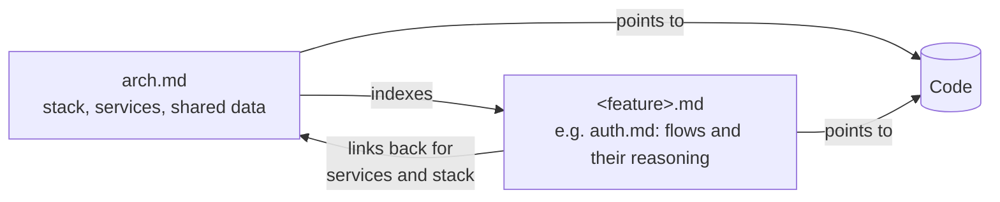

# Contributing to docs

The docs in this folder are living documents. They describe the system's intended state and are updated in the same change as the code they describe. They are written for two readers: developers who need to understand the system, and AI agents that need to understand its intent.

## Structure

### arch.md

The primary architecture document. It holds everything that spans more than one service or feature:

- The tech stack, and why each choice was made.
- Each service: its purpose, responsibilities, and where its code lives.
- How services interact, and their dependencies.
- Table-like data shared between services, such as error codes, configuration variables, permission matrices, or message topics.
- Cross-service strategies, such as authentication, data storage, and general code style. Summarize each in a paragraph and link to the feature doc for the details.
- An index of the feature docs.

It does not describe feature-specific flows. Those belong in a feature doc.

### Feature docs (`<feature>.md`)

One doc per feature domain, e.g. [auth.md](auth.md). A feature doc holds:

- The domain's rules and data (e.g. token lifetimes in auth.md).
- A diagram for each non-trivial flow.
- Why each flow works the way it does: the problem it solves and the alternatives it rules out.
- Pointers to the code that implements the domain.

Refer back to arch.md rather than redefining anything there. If a flow uses the api, link to [the api section](arch.md#api) instead of describing the api again.

Add related flows to the existing doc for their domain. Create a new feature doc only for a genuinely separate domain, and add it to the index in arch.md when you do.

## Writing rules

- **Stay high level.** Explain how the pieces fit and why. Include implementation details only where they illustrate a point or are a contract others depend on (e.g. token formats, error codes).
- **Point to code; don't copy it.** Link to files and directories with relative paths. Use a code snippet only when it illustrates something prose and a link can't.
- **Diagrams are Mermaid.** No ASCII art or images. Use `sequenceDiagram` for flows between components and `flowchart` for structure.
- **One home per fact.** If something already lives in arch.md, another doc, `CLAUDE.md`, or the OpenAPI spec, link to it.
- **Describe the intended state.** No "currently", "for now", "not yet", or progress notes. A gap is worth mentioning only when it is deliberate and long term.
- **List only what exists.** Don't add speculative components (caches, brokers, etc.) until there is a concrete need for them.
- **Keep docs current.** A change that alters a flow, a service boundary, or shared data updates the matching doc in the same commit.
