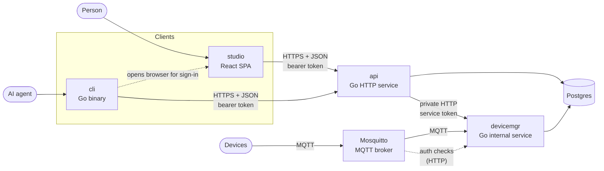
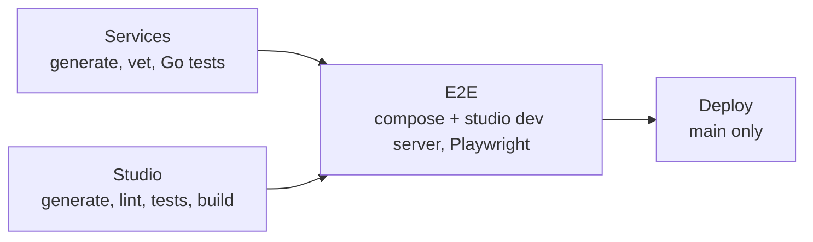

# Architecture

dalnamics is a platform that people drive through a web app (studio) and AI agents drive through a command-line client (cli). Both are clients of one HTTP api, which owns user-facing state in Postgres. Hardware devices talk to devicemgr, an internal service that owns device data and that only the api calls. The hardware the platform controls lives in [`harwood0/`](../harwood0/), which has its own [architecture](../harwood0/docs/architecture.md).

Feature domains, and the flows within them, are documented separately:

| Doc | Domain |
|---|---|
| [auth.md](auth.md) | Accounts, sessions and tokens, studio and cli sign-in |
| [devices.md](devices.md) | Device registration, device credentials, broker authorization, and connectivity |

## System overview

- Clients never talk to each other, to devicemgr, or to the database. Every read and write goes through the api.
- Devices talk only to devicemgr, over MQTT through Mosquitto. The broker delegates every authentication and topic check to devicemgr ([devices.md](devices.md#broker-authorization)). The api surfaces device data by reading devicemgr's schema and sends requests to devices through devicemgr's private API.
- The only client-to-client hand-off is the cli opening studio in a browser so a person can approve a cli sign-in ([auth.md](auth.md#cli-login)).

## Tech stack

| Concern | Choice | Why |
|---|---|---|
| Backend services | Go, one module per service (api, cli, devicemgr), joined by [`go.work`](../go.work) | One language for every service, so they share code in [`internal/`](../internal/) and the generated client stays in step with the server. |
| API contract | OpenAPI 3 ([`services/api/openapi.yaml`](../services/api/openapi.yaml); devicemgr's private [`services/devicemgr/openapi.yaml`](../services/devicemgr/openapi.yaml)) | A single spec generates the Go server, the Go client, and studio's types, so the contract cannot drift between them. |
| Code generation | oapi-codegen (Go server and client), openapi-typescript (studio), sqlc (queries), mockgen (mocks) | Generated code is committed and never hand-edited. Go tools are pinned as `tool` directives in each `go.mod`. |
| Database | Postgres 17 | The single store for all platform state, with one schema per service. Extensions are enabled per migration as needed. |
| Web app | React 19, Vite, TanStack Router, zustand, shadcn/Tailwind | File-based typed routes, small client-side stores, and owned (copied-in) UI components. |
| CLI | Cobra | Conventional subcommand structure that agents can discover with `--help`. |
| Device transport | MQTT 5 through Mosquitto with the mosquitto-go-auth plugin | Devices hold long-lived connections, publish and subscribe on topics, and often sit behind NAT, which MQTT handles and request/response HTTP doesn't. The plugin's HTTP backend sends authentication and ACL checks to devicemgr, so Postgres is the only store of device credentials. |
| Local stack | Docker Compose ([`docker-compose.yaml`](../docker-compose.yaml)) | Every app service builds and runs in compose. Go services support delve attach from VS Code. |
| Testing | Go: testify + gomock. Studio: Vitest + Testing Library. E2E: Playwright | See [Testing](#testing). |

## Services

### api

[`services/api/`](../services/api/) is the front-facing HTTP service. It owns the `public` schema and is the only service clients reach.

- **Contract:** the OpenAPI spec is the source of truth. Changes are spec-first: edit the spec, run `make generate`, then implement the generated `StrictServerInterface` in [`internal/server`](../services/api/internal/server/).
- **Layers:** handlers in `server` translate between generated types and domain services (e.g. [`internal/auth`](../services/api/internal/auth/)). Domain services depend only on the composed `store.Querier` ([`internal/store`](../services/api/internal/store/store.go)).
- **Authorization:** an operation requires a bearer token when the spec declares `security: [{bearerAuth: []}]`. The server reads this from the spec at startup, so there is no second list to maintain.
- **Errors:** domain code returns sentinel errors. [`server/errors.go`](../services/api/internal/server/errors.go) maps them to a status and a stable [error code](#error-codes).
- **Migrations** are embedded in the binary and applied at startup.

### devicemgr

[`services/devicemgr/`](../services/devicemgr/) is the internal device service. Devices are generic hardware nodes (harwood0 is one kind). devicemgr takes in incoming device data, tracks where devices are, and carries downstream requests from the api to devices.

- **No public API:** studio and the cli never call devicemgr. The api calls it, and the api surfaces the data devicemgr writes.
- **Device transport:** connects to Mosquitto as the MQTT superuser, answers device registration handshakes, and records device heartbeats ([`internal/mqtt`](../services/devicemgr/internal/mqtt/)). Mosquitto in turn calls devicemgr's `/mqtt/*` operations to authenticate clients and authorize each topic ([devices.md](devices.md)).
- **Connectivity:** records each device's heartbeats, which keep the device online until they stop ([devices.md](devices.md#connectivity)).
- **Contract:** a private OpenAPI spec ([`openapi.yaml`](../services/devicemgr/openapi.yaml)), changed spec-first the same way as the api's and generated into [`internal/apigen`](../services/devicemgr/internal/apigen/).
- **Authorization:** every route requires the shared service token ([Authentication](#authentication)) unless the spec declares empty security, which only `/healthz` and the broker's `/mqtt/*` checks do. [`internal/server`](../services/devicemgr/internal/server/server.go) reads the open operations from the spec.
- **Data:** owns the `devicemgr` Postgres schema. Its migrations ([`internal/store/migrations`](../services/devicemgr/internal/store/migrations/)) are embedded and applied at startup ([Data](#data)).

### cli

[`services/cli/`](../services/cli/) is a Cobra command-line client over the api, and the interface AI agents use to drive the platform.

- Calls the api through the client generated from the same spec ([`internal/client`](../services/cli/internal/client/)), wrapped with a transport that attaches and refreshes tokens.
- Keeps credentials per api URL, so one machine can be signed in to several environments ([auth.md](auth.md#cli-credential-storage)).

### studio

[`studio/`](../studio/) is the web app for people. It is a self-contained pnpm project built to static files.

- Calls the api through `openapi-fetch` with types generated from the spec. [`src/lib/api/client.ts`](../studio/src/lib/api/client.ts) exports an unauthenticated client and one that attaches and refreshes tokens.
- Routes are files under [`src/routes`](../studio/src/routes/). Pages that need a signed-in user live under `_authed/`.
- Client state lives in zustand stores under [`src/stores`](../studio/src/stores/).

### Shared Go code

[`internal/`](../internal/) (module `dalnamics/internal`) holds code every Go service uses, such as the [health handler](../internal/health/health.go) each service exposes at `/healthz`.

## Cross-service concerns

### Authentication

Every client authenticates to the api with a short-lived bearer access token and renews it with a single-use refresh token. Each sign-in creates a server-side session tagged with its client (`studio` or `cli`), so sessions can be revoked individually and revocation takes effect immediately. The api is the only component that reads or writes auth data. Flows and the reasoning behind them are in [auth.md](auth.md).

Devices authenticate to the broker with their own ID and secret, issued when they redeem a one-time registration code. devicemgr checks them on the broker's behalf ([devices.md](devices.md)).

Service-to-service calls use a shared secret. The api calls devicemgr with `Authorization: Bearer <DEVICEMGR_TOKEN>`, which devicemgr compares in constant time; a missing or wrong token gets `unauthenticated`.

### Data

- Each service owns one Postgres schema: `public` for the api, `devicemgr` for devicemgr. A service writes only its own schema, and no foreign key crosses schemas, so neither service's migrations depend on the other's. Two cross-schema reads are allowed: the api reads devicemgr's tables to surface device data, and devicemgr reads `public.device_registration_codes` to redeem a code. A schema a service creates carries a `COMMENT ON SCHEMA`.
- Data the api keeps about devicemgr's records lives in an api table that overlays devicemgr's when read. User-facing display data for a device is a user concern, not a device concern, so it lives in the api's `public.device_profiles`, one optional row per device, keyed by devicemgr's device ID with no cross-schema foreign key. The api's reads `LEFT JOIN` it onto `devicemgr.devices` and prefer its non-null fields, and the api never writes devicemgr's schema to change them, which keeps one writer per schema. devicemgr never reads `device_profiles`, because devices don't need display data. See [devices.md](devices.md#renaming).
- Each service migrates its schema at startup with its own tracking table (`schema_migrations` for the api, `public.devicemgr_schema_migrations` for devicemgr). golang-migrate creates the tracking table before any migration runs, so it cannot live in a schema that a migration creates.
- SQL is written by hand in each service's `store/queries` (e.g. the [api's](../services/api/internal/store/queries/)). sqlc generates one package per domain under `store/` (e.g. `store/auth`), and the root `store` package composes them into one `Querier`, the only thing application code depends on and the only thing mocked. A domain that reads the other service's schema lists that service's migrations in its sqlc `schema`. The api's `Querier.InTx` runs a function against one transaction.
- Migrations live in each service's `store/migrations` (e.g. the [api's](../services/api/internal/store/migrations/)) as `{version}_{name}.{up,down}.sql`. Cross-cutting behavior (e.g. `updated_at` via `set_updated_at()`) is done with triggers. Each schema has its own `set_updated_at()`, because the services migrate independently and in no fixed order. Every table except `users` and pure join tables carries a `COMMENT ON TABLE`.

### Error codes

Error responses from every service share one shape, `{code, message}`. Clients switch on `code`, never on `message`.

| Code | Status | Meaning |
|---|---|---|
| `invalid_request` | 400 | The request failed decoding or validation |
| `invalid_code` | 400 | A one-time authorization or registration code is invalid, expired, or already used (also a device handshake reply) |
| `invalid_credentials` | 401 | Wrong email or password |
| `invalid_token` | 401 | A refresh token is unknown, expired, or reused |
| `unauthenticated` | 401 | Missing or invalid access token or service token, or the session has ended |
| `not_dev_user` | 401 | Dev login with an address not in `DEV_EMAILS` |
| `email_taken` | 409 | Sign-up with an email that already has an account |
| `not_found` | 404 | Unknown resource, or a dev-only endpoint outside `DEBUG` |
| `internal` | 500 | Unexpected failure; details are logged, not returned |

### Configuration

Services are configured from the environment through a typed `config` package (e.g. [api config](../services/api/internal/config/config.go)); there are no globals. Studio reads `VITE_*` variables through [`src/lib/config.ts`](../studio/src/lib/config.ts). Local defaults are in [`services/api/.env.example`](../services/api/.env.example), [`services/devicemgr/.env.example`](../services/devicemgr/.env.example), and [`studio/.env.development`](../studio/.env.development).

| Variable | Service | Purpose |
|---|---|---|
| `API_ADDR` | api | Listen address |
| `DATABASE_URL` | api, devicemgr | Postgres connection string |
| `JWT_SECRET` | api | Signs access tokens; at least 32 bytes |
| `DEBUG` | api | Enables development-only behavior, such as dev users |
| `DEV_EMAILS` | api | Dev user addresses, comma separated (read only when `DEBUG=true`) |
| `DEV_REGISTRATION_CODE` | api | [Device registration code](devices.md#dev-registration-code) seeded for the first dev user; never expires (read only when `DEBUG=true`) |
| `DEVICEMGR_ADDR` | devicemgr | Listen address |
| `DEVICEMGR_TOKEN` | devicemgr | Shared service token callers present as a bearer token; at least 32 bytes |
| `DEVICEMGR_MQTT_URL` | devicemgr | MQTT broker URL (`mqtt://host:port`) |
| `DEVICEMGR_MQTT_PASSWORD` | devicemgr | devicemgr's broker password as the `devicemgr` superuser; at least 32 bytes |
| `DEVICEMGR_OFFLINE_AFTER` | devicemgr | How long a device stays [online](devices.md#connectivity) after a heartbeat (Go duration, default `90s`) |
| `DALNAMICS_API_URL` / `--api-url` | cli | api base URL |
| `VITE_DEVICES_REFRESH_MS` | studio | How long the Devices page and each device's page wait after one refresh of [device status](devices.md#connectivity) before the next, in milliseconds (default `15000`; [`studio/.env.development`](../studio/.env.development) sets `5000` for the dev server). Read when studio is built or the dev server starts |
| `DALNAMICS_STUDIO_URL` / `--studio-url` | cli | studio base URL, for browser sign-in |
| `DALNAMICS_CREDENTIAL_STORE` | cli | Forces the credential backend (`keyring` or `file`) |
| `DALNAMICS_CONFIG_DIR` | cli | Relocates the cli's credentials file and lock files |

### Code style

- **Go:** flat packages, one per concern, with topics split into files (e.g. `auth/{service,tokens,password,pkce}.go`). App-specific code sits in `services/<svc>/internal/`, and each `main` in `services/<svc>/cmd/`. Subpackages only for a real boundary.
- **Studio:** routes as files, API access only through the shared clients, state in zustand stores.
- Detailed conventions for working in the repo are in [CLAUDE.md](../CLAUDE.md).

## Testing

- **Go unit tests** exercise handlers and domain services against the generated `mockstore`.
- **Studio unit tests** render real routes with [`renderRoute`](../studio/src/test/render.tsx) and stub the api with [`mockApi`](../studio/src/test/api.ts).
- **E2E tests** in [`test/studio`](../test/studio/) run against the compose Postgres, api, devicemgr, and Mosquitto, and the studio dev server. Device tests play the device's side over MQTT. The api seeds dev users so tests sign in without passwords ([auth.md](auth.md#dev-users)).

### CI

[`.github/workflows/ci.yml`](../.github/workflows/ci.yml) runs on every pull request and every push to `main`. It is the gate a change must pass before merging.

Both build jobs fail if code generation changes any committed file, so generated code can never drift from its sources.

## Local development

| Component | How it runs | Port |
|---|---|---|
| Postgres | compose | 5433 (host) |
| api | compose, or on the host with `make run-api` | 8080; delve on 2345 in compose |
| devicemgr | compose, or on the host with `make run-devicemgr` (the compose broker can only reach the compose devicemgr for auth checks) | 8081; delve on 2346 in compose |
| Mosquitto | compose ([`mosquitto.conf`](../services/devicemgr/mosquitto/mosquitto.conf)) | 1883 (MQTT) |
| studio | Vite dev server (`make run-studio`) | 5173 |

`make up` builds and starts the full stack; `make generate`, `make test`, `make test-e2e`, and `make lint` cover the day-to-day loop (see the [Makefile](../Makefile)).
