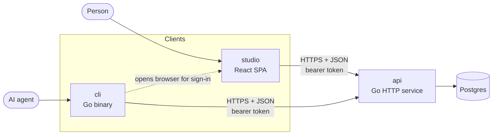
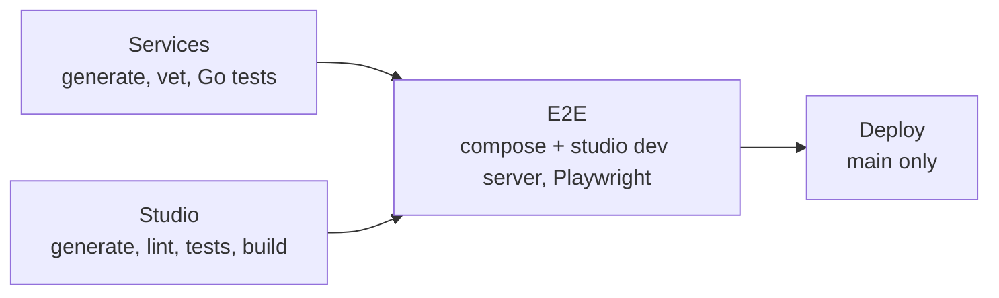

# Architecture

dalnamics is a platform that people drive through a web app (studio) and AI agents drive through a command-line client (cli). Both are clients of one HTTP api, which owns all state in Postgres. The hardware the platform controls lives in [`harwood0/`](../harwood0/), which has its own [architecture](../harwood0/docs/architecture.md).

Feature domains, and the flows within them, are documented separately:

| Doc | Domain |
|---|---|
| [auth.md](auth.md) | Accounts, sessions and tokens, studio and cli sign-in |

## System overview

- Clients never talk to each other or to the database. Every read and write goes through the api.
- The only client-to-client hand-off is the cli opening studio in a browser so a person can approve a cli sign-in ([auth.md](auth.md#cli-login)).

## Tech stack

| Concern | Choice | Why |
|---|---|---|
| Backend services | Go, one module per service, joined by [`go.work`](../go.work) | One language for the api and cli, so they share code in [`internal/`](../internal/) and the generated client stays in step with the server. |
| API contract | OpenAPI 3 ([`services/api/openapi.yaml`](../services/api/openapi.yaml)) | A single spec generates the Go server, the Go client, and studio's types, so the contract cannot drift between them. |
| Code generation | oapi-codegen (Go server and client), openapi-typescript (studio), sqlc (queries), mockgen (mocks) | Generated code is committed and never hand-edited. Go tools are pinned as `tool` directives in each `go.mod`. |
| Database | Postgres 17 | The single store for all api state. Extensions are enabled per migration as needed. |
| Web app | React 19, Vite, TanStack Router, zustand, shadcn/Tailwind | File-based typed routes, small client-side stores, and owned (copied-in) UI components. |
| CLI | Cobra | Conventional subcommand structure that agents can discover with `--help`. |
| Local stack | Docker Compose ([`docker-compose.yaml`](../docker-compose.yaml)) | Every app service builds and runs in compose. Go services support delve attach from VS Code. |
| Testing | Go: testify + gomock. Studio: Vitest + Testing Library. E2E: Playwright | See [Testing](#testing). |

## Services

### api

[`services/api/`](../services/api/) is the front-facing HTTP service and the only component with database access.

- **Contract:** the OpenAPI spec is the source of truth. Changes are spec-first: edit the spec, run `make generate`, then implement the generated `StrictServerInterface` in [`internal/server`](../services/api/internal/server/).
- **Layers:** handlers in `server` translate between generated types and domain services (e.g. [`internal/auth`](../services/api/internal/auth/)). Domain services depend only on the composed `store.Querier` ([`internal/store`](../services/api/internal/store/store.go)).
- **Authorization:** an operation requires a bearer token when the spec declares `security: [{bearerAuth: []}]`. The server reads this from the spec at startup, so there is no second list to maintain.
- **Errors:** domain code returns sentinel errors. [`server/errors.go`](../services/api/internal/server/errors.go) maps them to a status and a stable [error code](#error-codes).
- **Migrations** are embedded in the binary and applied at startup.

### cli

[`services/cli/`](../services/cli/) is a Cobra command-line client over the api, and the interface AI agents use to drive the platform.

- Calls the api through the client generated from the same spec ([`internal/client`](../services/cli/internal/client/)), wrapped with a transport that attaches and refreshes tokens.
- Keeps credentials per api URL, so one machine can be signed in to several environments ([auth.md](auth.md#cli-credential-storage)).

### studio

[`studio/`](../studio/) is the web app for people. It is a self-contained pnpm project built to static files.

- Calls the api through `openapi-fetch` with types generated from the spec. [`src/lib/api/client.ts`](../studio/src/lib/api/client.ts) exports an unauthenticated client and one that attaches and refreshes tokens.
- Routes are files under [`src/routes`](../studio/src/routes/). Pages that need a signed-in user live under `_authed/`.
- Client state lives in zustand stores under [`src/stores`](../studio/src/stores/).

### Shared Go code

[`internal/`](../internal/) (module `dalnamics/internal`) holds code every Go service uses, such as the [health handler](../internal/health/health.go) each service exposes at `/healthz`.

## Cross-service concerns

### Authentication

Every client authenticates to the api with a short-lived bearer access token and renews it with a single-use refresh token. Each sign-in creates a server-side session tagged with its client (`studio` or `cli`), so sessions can be revoked individually and revocation takes effect immediately. The api is the only component that reads or writes auth data. Flows and the reasoning behind them are in [auth.md](auth.md).

### Data

- Postgres is owned by the api. Other services reach data only through the api.
- SQL is written by hand in [`store/queries`](../services/api/internal/store/queries/). sqlc generates one package per domain under `store/` (e.g. `store/auth`), and the root `store` package composes them into one `Querier`, the only thing application code depends on and the only thing mocked.
- Migrations live in [`store/migrations`](../services/api/internal/store/migrations/) as `{version}_{name}.{up,down}.sql`. Cross-cutting behavior (e.g. `updated_at` via `set_updated_at()`) is done with triggers. Every table except `users` and pure join tables carries a `COMMENT ON TABLE`.

### Error codes

Error responses share one shape, `{code, message}`. Clients switch on `code`, never on `message`.

| Code | Status | Meaning |
|---|---|---|
| `invalid_request` | 400 | The request failed decoding or validation |
| `invalid_code` | 400 | A one-time authorization code is invalid, expired, or already used |
| `invalid_credentials` | 401 | Wrong email or password |
| `invalid_token` | 401 | A refresh token is unknown, expired, or reused |
| `unauthenticated` | 401 | Missing or invalid access token, or the session has ended |
| `not_dev_user` | 401 | Dev login with an address not in `DEV_EMAILS` |
| `email_taken` | 409 | Sign-up with an email that already has an account |
| `not_found` | 404 | Unknown resource, or a dev-only endpoint outside `DEBUG` |
| `internal` | 500 | Unexpected failure; details are logged, not returned |

### Configuration

Services are configured from the environment through a typed `config` package (e.g. [api config](../services/api/internal/config/config.go)); there are no globals. Local defaults for the api are in [`services/api/.env.example`](../services/api/.env.example).

| Variable | Service | Purpose |
|---|---|---|
| `API_ADDR` | api | Listen address |
| `DATABASE_URL` | api | Postgres connection string |
| `JWT_SECRET` | api | Signs access tokens; at least 32 bytes |
| `DEBUG` | api | Enables development-only behavior, such as dev users |
| `DEV_EMAILS` | api | Dev user addresses, comma separated (read only when `DEBUG=true`) |
| `DALNAMICS_API_URL` / `--api-url` | cli | api base URL |
| `DALNAMICS_STUDIO_URL` / `--studio-url` | cli | studio base URL, for browser sign-in |
| `DALNAMICS_CREDENTIAL_STORE` | cli | Forces the credential backend (`keyring` or `file`) |
| `DALNAMICS_CONFIG_DIR` | cli | Relocates the cli's credentials file and lock files |

### Code style

- **Go:** flat packages, one per concern, with topics split into files (e.g. `auth/{service,tokens,password,pkce}.go`). App-specific code sits in `services/<svc>/internal/`, and each `main` in `services/<svc>/cmd/`. Subpackages only for a real boundary.
- **Studio:** routes as files, API access only through the shared clients, state in zustand stores.
- Detailed conventions for working in the repo are in [CLAUDE.md](../CLAUDE.md).

## Testing

- **Go unit tests** exercise handlers and domain services against the generated `mockstore`.
- **Studio unit tests** render real routes with [`renderRoute`](../studio/src/test/render.tsx) and stub the api with [`mockApi`](../studio/src/test/api.ts).
- **E2E tests** in [`test/studio`](../test/studio/) run against the compose Postgres and api and the studio dev server. The api seeds dev users so tests sign in without passwords ([auth.md](auth.md#dev-users)).

### CI

[`.github/workflows/ci.yml`](../.github/workflows/ci.yml) runs on every pull request and every push to `main`. It is the gate a change must pass before merging.

Both build jobs fail if code generation changes any committed file, so generated code can never drift from its sources.

## Local development

| Component | How it runs | Port |
|---|---|---|
| Postgres | compose | 5433 (host) |
| api | compose, or on the host with `make run-api` | 8080; delve on 2345 in compose |
| studio | Vite dev server (`make run-studio`) | 5173 |

`make up` builds and starts the full stack; `make generate`, `make test`, `make test-e2e`, and `make lint` cover the day-to-day loop (see the [Makefile](../Makefile)).
