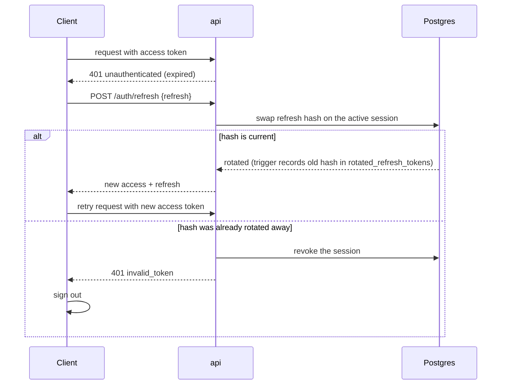

# Authentication

Accounts are identified by email. Clients authenticate to the [api](arch.md#api) with short-lived bearer **access tokens** and renew them with single-use **refresh tokens**. The api is the only component that reads or writes auth data; studio and the cli only hold tokens.

Related: [error codes](arch.md#error-codes) and [configuration](arch.md#configuration) are shared across services and listed in arch.md.

| Where | Code |
|---|---|
| api | [`internal/auth`](../services/api/internal/auth/) (domain), [`server/auth_handlers.go`](../services/api/internal/server/auth_handlers.go), [`queries/auth.sql`](../services/api/internal/store/queries/auth.sql), [migrations](../services/api/internal/store/migrations/) |
| studio | [`stores/auth.ts`](../studio/src/stores/auth.ts), [`lib/api/client.ts`](../studio/src/lib/api/client.ts), [`routes/login.tsx`](../studio/src/routes/login.tsx), [`routes/_authed/cli-login.tsx`](../studio/src/routes/_authed/cli-login.tsx) |
| cli | [`commands/auth.go`](../services/cli/internal/commands/auth.go), [`login`](../services/cli/internal/login/), [`credentials`](../services/cli/internal/credentials/), [`client/transport.go`](../services/cli/internal/client/transport.go) |

## Accounts

- Users sign up with email, name, and password (`POST /auth/signup`) and log in with email and password (`POST /auth/login`).
- Emails are trimmed, lowercased, and unique (`citext`).
- Passwords are 8–128 characters and stored as argon2id hashes (PHC string format).
- Unknown emails and wrong passwords produce the same `invalid_credentials` error and take the same time to reject, so the api never reveals which emails have accounts.
- Accounts without a password (dev users, and future external identity providers) have a NULL password hash and cannot use password login.

## Sessions and tokens

Every sign-in creates a session, tagged with the client (`studio` or `cli`). Sessions exist so that each sign-in can be revoked on its own and so that revocation takes effect immediately, which a stateless JWT alone cannot do.

| Token | Format | Lifetime | Stored server-side as |
|---|---|---|---|
| Access | HS256 JWT; `sub` = user id, `sid` = session id | 15 min | not stored |
| Refresh | 32 random bytes, base64url | until the session expires, 7 days after sign-in | SHA-256 in `sessions.refresh_token_hash` |

- **Authenticated requests** send `Authorization: Bearer <access>`. The api verifies the JWT and confirms the session is still active, so logout takes effect immediately.
- **Refresh** (`POST /auth/refresh`) atomically swaps the session's refresh hash for a new one, so each refresh token works once. Refreshing does not extend the session; users sign in again after 7 days.
- **Logout** (`POST /auth/logout`) revokes the session, which invalidates both of its tokens.

### Refresh and reuse detection

Single-use refresh tokens let the api detect a stolen token: if two parties hold the same token, whichever presents it second is presenting a hash that has already been rotated away. The api cannot tell which party is legitimate, so it revokes the session and both must sign in again.



Because a reused token revokes the session, a client must never present a refresh token that a concurrent refresh already rotated. Clients refresh once per 401 and coordinate:

- **Studio** shares one in-flight refresh across concurrent requests. Tabs take turns through a Web Lock, and each tab adopts tokens another tab already rotated. Tabs follow each other's refreshes and sign-outs through `storage` events.
- **The cli** serializes refreshes across processes with a lock file in its config directory, then persists the rotated pair. The credentials file is also locked while being rewritten.

## Studio sign-in

Studio signs in with password or, in development, [dev users](#dev-users). It keeps the user and token pair in localStorage (`dalnamics-auth`) through a persisted zustand store, and the `api` client attaches the access token to every request. Pages under `_authed/` redirect to `/login?redirect=…` when there is no user, and return there after sign-in.

## CLI login

The cli is used from terminals and by agents, where typing a password is undesirable, and it should never handle the user's password at all. `cli auth login` instead follows the OAuth native-app pattern ([RFC 8252](https://datatracker.ietf.org/doc/html/rfc8252)): a loopback redirect with PKCE (S256). The person signs in through studio in a browser, and the cli receives its own session.

```mermaid
sequenceDiagram
    participant CLI as cli
    participant B as Browser (studio)
    participant API as api
    CLI->>CLI: verifier, challenge = S256(verifier), state; listen on 127.0.0.1:<port>
    CLI->>B: open /cli-login?redirect_uri&code_challenge&state
    B->>B: log in if needed, user clicks Authorize
    B->>API: POST /auth/cli/authorize {code_challenge, redirect_uri} (bearer)
    API-->>B: one-time code (60s, stored as SHA-256)
    B->>CLI: GET http://127.0.0.1:<port>/callback?code&state
    CLI->>API: POST /auth/cli/token {code, code_verifier, redirect_uri}
    API-->>CLI: user + tokens for a new cli session
```

- The api accepts only `http` loopback redirect URIs with an explicit port. Studio checks the URI before redirecting, including on Cancel, so the page cannot be used as an open redirect.
- The code is single use and bound to the challenge and redirect URI. A code intercepted without the verifier is useless. A redemption with the wrong verifier or redirect URI is rejected without using up the code.
- The cli ignores callbacks whose `state` doesn't match.

### CLI credential storage

Credentials are keyed by api URL, so one machine can be signed in to several environments.

- **Default:** the OS keychain (macOS Keychain, Linux Secret Service, Windows Credential Manager), under service `dalnamics-cli`.
- **No keychain** (e.g. headless containers): an owner-only (0600) file at `<user config dir>/dalnamics/credentials.json`.
- `DALNAMICS_CREDENTIAL_STORE` forces a backend and `DALNAMICS_CONFIG_DIR` relocates the file and lock files ([configuration](arch.md#configuration)).

## Dev users

Development and E2E tests need to sign in as known users without managing passwords. When the api runs with `DEBUG=true`, each address in `DEV_EMAILS` is created at startup if it doesn't exist. Dev users have no password.

- `GET /auth/dev-users` lists the addresses, and studio renders them as one-click login buttons.
- `POST /auth/dev-login` signs one in. E2E tests and `cli auth login --dev <email>` use the same endpoint.
- Without `DEBUG=true`, both endpoints return 404 and `DEV_EMAILS` is ignored, so the feature does not exist in production.
