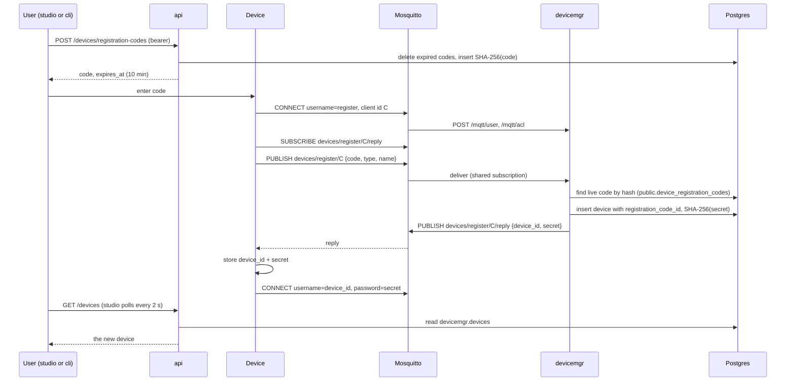

# Devices

A device is a piece of hardware linked to one user's account, such as a [harwood0](../harwood0/) robot. Devices talk to the platform over MQTT through the broker, never over the [api](arch.md#api). [devicemgr](arch.md#devicemgr) registers them, owns their records, and decides what each one may do on the broker. Users see their devices through the api, which reads devicemgr's schema ([Data](arch.md#data)).

Related: [error codes](arch.md#error-codes) and [configuration](arch.md#configuration) are shared across services and listed in arch.md.

| Where | Code |
|---|---|
| api | [`internal/devices`](../services/api/internal/devices/) (codes, listing), [`server/devices_handlers.go`](../services/api/internal/server/devices_handlers.go), [`queries/devices.sql`](../services/api/internal/store/queries/devices.sql) |
| devicemgr | [`internal/devices`](../services/devicemgr/internal/devices/) (redemption, broker rules), [`internal/mqtt`](../services/devicemgr/internal/mqtt/) (handshake), [`server/mqtt_auth_handlers.go`](../services/devicemgr/internal/server/mqtt_auth_handlers.go), [`queries/devices.sql`](../services/devicemgr/internal/store/queries/devices.sql) |
| Broker | [`mosquitto/mosquitto.conf`](../services/devicemgr/mosquitto/mosquitto.conf) |
| studio | [`routes/_authed/_app/devices.tsx`](../studio/src/routes/_authed/_app/devices.tsx), [`components/register-device-dialog.tsx`](../studio/src/components/register-device-dialog.tsx), [`stores/devices.ts`](../studio/src/stores/devices.ts) |
| cli | [`commands/devices.go`](../services/cli/internal/commands/devices.go) |
| harwood0 | [`harwood0_api/platform.py`](../harwood0/api/src/harwood0_api/platform.py) |

## Device model

| Field | Meaning |
|---|---|
| `id` | UUID assigned at registration. The device's MQTT username |
| `user_id` | The user who issued the code the device redeemed |
| `type` | Kind of device, `^[a-z0-9-]{1,64}$` (e.g. `harwood0`) |
| `name` | 1–100 characters; defaults to `type` |
| `secret_hash` | SHA-256 of the device's secret, its MQTT password |
| `registration_code_id` | The code the device redeemed; unique |

Devices live in `devicemgr.devices`. Registration codes live in the api's `public.device_registration_codes`.

## Registration

A person can't type an account password into a robot, and a robot shouldn't hold one. Instead, a signed-in user gets a short one-time code from studio's Devices page or `cli devices register`, and gives it to the device (for harwood0, `HARWOOD0_REGISTRATION_CODE`). The device redeems the code with devicemgr over MQTT and receives its own long-lived credentials. The code proves which user the device belongs to. The device never learns anything about the user's account.

### Code rules

- **Format:** 6 characters from `23456789ABCDEFGHJKLMNPQRSTUVWXYZ`, which leaves out 0/O and 1/I because people read codes off a screen and type them into a device. Codes are trimmed and uppercased before hashing, so they're case-insensitive. The 32-character alphabet gives about 10⁹ codes, enough to make guessing a live code within its lifetime impractical.
- **Lifetime:** 10 minutes. That's long enough to walk to a robot and configure it, and short enough that a leaked code is soon useless. Issuing a code doesn't revoke the user's other live codes. The api deletes expired codes when it issues a new one.
- **Single use:** `devicemgr.devices.registration_code_id` is unique, so a second redemption fails on insert. This keeps the single-use rule entirely in devicemgr's schema: devicemgr never writes the api's table to mark a code used.
- **Stored hashed:** only SHA-256 of the normalized code is stored, as with [cli login codes](auth.md#cli-login). A short, single-use, short-lived code needs no slow hash.
- **One error:** unknown, expired, and already-used codes all get `invalid_code`, so a device learns nothing about which codes exist.

### Dev registration code

Registering a local device through studio on every fresh database slows down development. When the api runs with `DEBUG=true` and `DEV_REGISTRATION_CODE` is set, it seeds that code at startup for the first address in [`DEV_EMAILS`](auth.md#dev-users). Compose and `.env.example` set it to `000000`, registered to `dev@dalnamics.local`.

- The code never expires. Its `expires_at` is `infinity`.
- It is still single use, but each api start gives it a new id, so it can be redeemed once more after a restart.
- It needn't follow the code format. `000000` is outside the alphabet, so it can never collide with an issued code.
- Without `DEBUG=true`, the variable is ignored.

### Handshake

The request goes to `devices/register/{client id}`, and the reply comes back on `devices/register/{client id}/reply`. Messages are JSON at QoS 1. The device subscribes to the reply topic before publishing, so it can't miss the reply. devicemgr reads requests through the shared subscription `$share/devicemgr/devices/register/+`, so each request is handled by exactly one devicemgr instance.

| Message | Payload |
|---|---|
| Request | `{"code": "AB3D7K", "type": "harwood0", "name": "bench-rover"}`. `name` is optional, and unknown fields are ignored so devices can send more later |
| Success | `{"device_id": "<uuid>", "secret": "<base64url, 32 random bytes>"}` |
| Error | `{"error": "invalid_code"}` (unknown, expired, or used code), `{"error": "invalid_request"}` (malformed JSON, bad `type` or `name`), or `{"error": "internal"}` |

## Device credentials

A device connects to the broker with its ID as the MQTT username and its secret as the password. The secret is shown only once, in the handshake reply. devicemgr stores its SHA-256 and compares hashes in constant time. Credentials don't expire. A device that loses them registers again with a new code, as a new device.

## Broker authorization

Mosquitto runs the [mosquitto-go-auth](https://github.com/iegomez/mosquitto-go-auth) plugin with its HTTP backend. For every CONNECT, the broker calls devicemgr's `/mqtt/user`. For every publish and subscribe, it calls `/mqtt/acl`. A 200 response allows the action, and anything else denies it. Credentials and rules therefore live only in Postgres and devicemgr, and the broker holds no state of its own. Caching is off, so a change to a device's record takes effect on its next connect.

The HTTP backend can't send headers, so the three `/mqtt/*` operations take no [service token](arch.md#authentication). They answer only allow or deny for the credentials they're given. This reveals nothing more than a CONNECT to the broker itself would.

| Identity | Username / password | May |
|---|---|---|
| devicemgr | `devicemgr` / `DEVICEMGR_MQTT_PASSWORD` | Everything (superuser) |
| Unregistered device | `register` / any non-empty password (the broker refuses an empty one before asking devicemgr) | Publish to `devices/register/{own client id}`; read and subscribe to `devices/register/{own client id}/reply` |
| Registered device | device ID / secret | Read, write, and subscribe within `devices/{device id}` and below |

Everything else is denied, including wildcard subscriptions that reach outside a device's own prefix (e.g. `devices/+/telemetry`).
