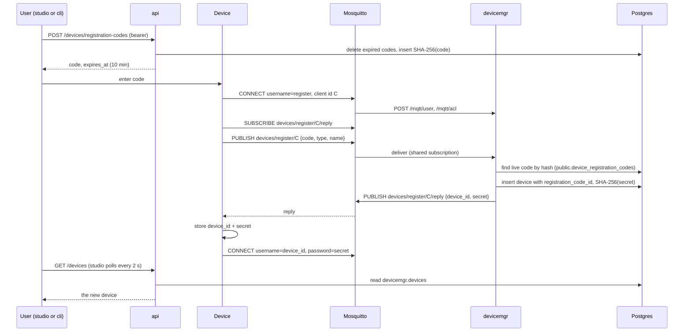
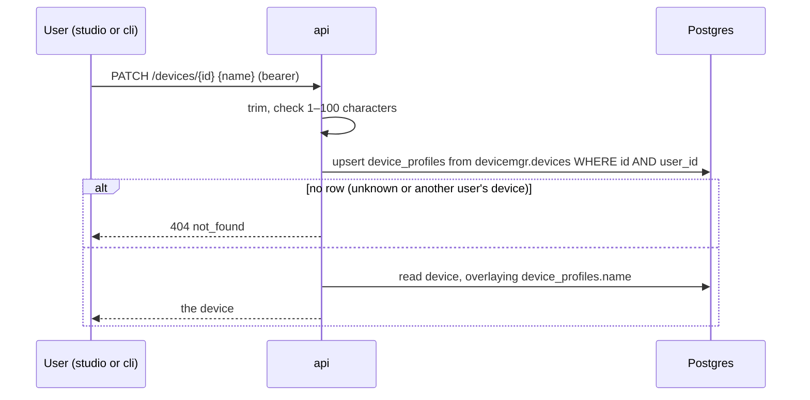
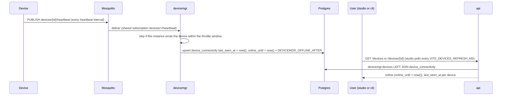

# Devices

A device is a piece of hardware linked to one user's account, such as a [harwood0](../harwood0/) robot. Devices talk to the platform over MQTT through the broker, never over the [api](arch.md#api). [devicemgr](arch.md#devicemgr) registers them, owns their records, decides what each one may do on the broker, and tracks whether each one is online. Users see their devices through the api, which reads devicemgr's schema ([Data](arch.md#data)).

Related: [error codes](arch.md#error-codes) and [configuration](arch.md#configuration) are shared across services and listed in arch.md.

| Where | Code |
|---|---|
| api | [`internal/devices`](../services/api/internal/devices/) (codes, listing and getting with connectivity, renaming), [`server/devices_handlers.go`](../services/api/internal/server/devices_handlers.go), [`queries/devices.sql`](../services/api/internal/store/queries/devices.sql), [`0004_create_device_profiles.up.sql`](../services/api/internal/store/migrations/0004_create_device_profiles.up.sql) |
| devicemgr | [`internal/devices`](../services/devicemgr/internal/devices/) (redemption, broker rules, [`presence.go`](../services/devicemgr/internal/devices/presence.go)), [`internal/mqtt`](../services/devicemgr/internal/mqtt/) (routing, handshake, [`presence.go`](../services/devicemgr/internal/mqtt/presence.go)), [`server/mqtt_auth_handlers.go`](../services/devicemgr/internal/server/mqtt_auth_handlers.go), [`queries/devices.sql`](../services/devicemgr/internal/store/queries/devices.sql) |
| Broker | [`mosquitto/mosquitto.conf`](../services/devicemgr/mosquitto/mosquitto.conf) |
| studio | [`routes/_authed/_app/devices.tsx`](../studio/src/routes/_authed/_app/devices.tsx) (list), [`routes/_authed/_app/devices_.$deviceId.tsx`](../studio/src/routes/_authed/_app/devices_.$deviceId.tsx) (details), [`components/register-device-dialog.tsx`](../studio/src/components/register-device-dialog.tsx), [`components/device-status.tsx`](../studio/src/components/device-status.tsx), [`components/device-name-editor.tsx`](../studio/src/components/device-name-editor.tsx), [`stores/devices.ts`](../studio/src/stores/devices.ts), [`stores/device.ts`](../studio/src/stores/device.ts), [`lib/use-refresh.ts`](../studio/src/lib/use-refresh.ts) |
| cli | [`commands/devices.go`](../services/cli/internal/commands/devices.go) (`devices register`, `list`, `get`, `rename`) |
| harwood0 | [`harwood0_api/platform.py`](../harwood0/api/src/harwood0_api/platform.py) |

## Device model

| Field | Meaning |
|---|---|
| `id` | UUID assigned at registration. The device's MQTT username |
| `user_id` | The user who issued the code the device redeemed |
| `type` | Kind of device, `^[a-z0-9-]{1,64}$` (e.g. `harwood0`) |
| `name` | The name the device registered with: 1–100 characters, defaulting to `type`. Users never change it ([Renaming](#renaming)) |
| `secret_hash` | SHA-256 of the device's secret, its MQTT password |
| `registration_code_id` | The code the device redeemed; unique |
| `online` | Whether the device has sent a heartbeat recently ([Connectivity](#connectivity)) |
| `last_seen_at` | When devicemgr last recorded a heartbeat from the device; null if it never connected |

Devices live in `devicemgr.devices`, and their connectivity in `devicemgr.device_connectivity`, one row per device from its first heartbeat. A user's name for a device lives in the api's `public.device_profiles.name`, and every read shows `coalesce(device_profiles.name, devices.name)` as the device's `name`. The name the device registered with is never shown once the user has named it. That row stores `last_seen_at` and `online_until`, and the api derives `online` as `online_until > now()`. Registration codes live in the api's `public.device_registration_codes`.

## Registration

A person can't type an account password into a robot, and a robot shouldn't hold one. Instead, a signed-in user gets a short one-time code from studio's Devices page or `cli devices register`, and gives it to the device (for harwood0, `HARWOOD0_REGISTRATION_CODE`). The device redeems the code with devicemgr over MQTT and receives its own long-lived credentials. The code proves which user the device belongs to. The device never learns anything about the user's account.

### Code rules

- **Format:** 6 characters from `23456789ABCDEFGHJKLMNPQRSTUVWXYZ`, which leaves out 0/O and 1/I because people read codes off a screen and type them into a device. Codes are trimmed and uppercased before hashing, so they're case-insensitive. The 32-character alphabet gives about 10⁹ codes, enough to make guessing a live code within its lifetime impractical.
- **Lifetime:** 10 minutes. That's long enough to walk to a robot and configure it, and short enough that a leaked code is soon useless. Issuing a code doesn't revoke the user's other live codes. The api deletes expired codes when it issues a new one.
- **Single use:** `devicemgr.devices.registration_code_id` is unique, so a second redemption fails on insert. This keeps the single-use rule entirely in devicemgr's schema: devicemgr never writes the api's table to mark a code used.
- **Stored hashed:** only SHA-256 of the normalized code is stored, as with [cli login codes](auth.md#cli-login). A short, single-use, short-lived code needs no slow hash.
- **One error:** unknown, expired, and already-used codes all get `invalid_code`, so a device learns nothing about which codes exist.

### Dev registration code

Registering a local device through studio on every fresh database slows down development. When the api runs with `DEBUG=true` and `DEV_REGISTRATION_CODE` is set, it seeds that code at startup for the first address in [`DEV_EMAILS`](auth.md#dev-users). Compose and `.env.example` set it to `000000`, registered to `dev@dalnamics.local`.

- The code never expires. Its `expires_at` is `infinity`.
- It is still single use, but each api start gives it a new id, so it can be redeemed once more after a restart.
- It needn't follow the code format. `000000` is outside the alphabet, so it can never collide with an issued code.
- Without `DEBUG=true`, the variable is ignored.

### Handshake

The request goes to `devices/register/{client id}`, and the reply comes back on `devices/register/{client id}/reply`. Messages are JSON at QoS 1. The device subscribes to the reply topic before publishing, so it can't miss the reply. devicemgr reads requests through the shared subscription `$share/devicemgr/devices/register/+`, so each request is handled by exactly one devicemgr instance. Its replies have one topic level too many to match, so devicemgr never receives them. devicemgr also holds a shared subscription for [heartbeats](#connectivity), `$share/devicemgr/devices/+/heartbeat`. The request of a client named `heartbeat` matches both filters and arrives twice, so each subscription carries its own MQTT subscription identifier, and devicemgr routes by that identifier, not by topic. The request is redeemed once.

| Message | Payload |
|---|---|
| Request | `{"code": "AB3D7K", "type": "harwood0", "name": "bench-rover"}`. `name` is optional, and unknown fields are ignored so devices can send more later |
| Success | `{"device_id": "<uuid>", "secret": "<base64url, 32 random bytes>"}` |
| Error | `{"error": "invalid_code"}` (unknown, expired, or used code), `{"error": "invalid_request"}` (malformed JSON, bad `type` or `name`), or `{"error": "internal"}` |

## Device credentials

A device connects to the broker with its ID as the MQTT username and its secret as the password. The secret is shown only once, in the handshake reply. devicemgr stores its SHA-256 and compares hashes in constant time. Credentials don't expire. A device that loses them registers again with a new code, as a new device.

## Broker authorization

Mosquitto runs the [mosquitto-go-auth](https://github.com/iegomez/mosquitto-go-auth) plugin with its HTTP backend. For every CONNECT, the broker calls devicemgr's `/mqtt/user`. For every publish and subscribe, it calls `/mqtt/acl`. A 200 response allows the action, and anything else denies it. Credentials and rules therefore live only in Postgres and devicemgr, and the broker holds no state of its own. Caching is off, so a change to a device's record takes effect on its next connect.

The HTTP backend can't send headers, so the three `/mqtt/*` operations take no [service token](arch.md#authentication). They answer only allow or deny for the credentials they're given. This reveals nothing more than a CONNECT to the broker itself would.

| Identity | Username / password | May |
|---|---|---|
| devicemgr | `devicemgr` / `DEVICEMGR_MQTT_PASSWORD` | Everything (superuser) |
| Unregistered device | `register` / any non-empty password (the broker refuses an empty one before asking devicemgr) | Publish to `devices/register/{own client id}`; read and subscribe to `devices/register/{own client id}/reply` |
| Registered device | device ID / secret | Read, write, and subscribe within `devices/{device id}` and below |

Everything else is denied, including wildcard subscriptions that reach outside a device's own prefix (e.g. `devices/+/telemetry`).

## Viewing devices

Users see their devices through the api's `GET /devices` and `GET /devices/{id}` ([api spec](../services/api/openapi.yaml)), which return only the caller's devices. Studio's Devices page lists them, and clicking a device's row or its name opens its page at `/devices/<id>`, which shows the device's name with its [status dot](#connectivity), and a table of its other public fields: ID, type, last seen, and registration time. The cli has `devices list` and `devices get <id>`.

A device ID is also the device's MQTT username, so the api never confirms which IDs exist. `GET /devices/{id}` matches on both the ID and the caller, and answers another user's device exactly as it answers an unknown ID: 404 `not_found` ([error codes](arch.md#error-codes)). Studio shows both as "Device not found" and stops refreshing the page, and `cli devices get` prints `device <id> not found`. Neither response includes the secret hash or the registration code ID.

## Renaming

A user renames a device from its page in studio, by clicking the pencil beside its name, or with `cli devices rename <id> <name>`. Both call `PATCH /devices/{id}` ([api spec](../services/api/openapi.yaml)), which returns the device with its new name. Studio then reloads its device list too, so the new name shows everywhere.

- **Name rules:** the same as at registration. The name is trimmed and must then be 1–100 characters, so a blank name gets 400 `invalid_request` rather than resetting the name. Names needn't be unique.
- **Ownership in one statement:** the upsert inserts only from the caller's own row in `devicemgr.devices`, so another user's device or an unknown ID creates no profile and gets 404 `not_found`, as [`GET /devices/{id}`](#viewing-devices) does. The upsert and the read-back run in one transaction.
- **The registered name stays in devicemgr:** `devicemgr.devices.name` is what the device reported when it registered. It stays there unchanged and queryable, and devicemgr is never asked to change it.
- **The user's name lives in the api:** a display name is a user concern, not a device concern, so it lives in the api's schema as a [device profile](arch.md#data) and devicemgr never reads it. Profiles are created on the first rename, so registration doesn't have to create one.
- **Editing in studio:** the pencil shows while the title is hovered or focused, and always on touch screens. Enter saves and Escape or clicking away cancels. The draft stays local, so a [refresh](#connectivity) during an edit doesn't disturb it.

## Connectivity

Users want to know which of their devices are reachable. A device counts as online while it keeps sending heartbeats, and goes offline once it has missed them for a threshold. Each heartbeat records an expiry, and the device is online until that expiry passes. No process has to mark it offline. Studio shows a green or gray dot beside each device's name, on the list and on the device's page, and `cli devices list` and `devices get` show a STATUS.

- **Offline by default:** a device with no connectivity row has never connected, so it is offline with `last_seen_at` null. The device's first heartbeat creates the row, and only for a device that exists; a heartbeat from an unknown ID is ignored.
- **Heartbeats only:** a device publishes an empty, unretained QoS 0 message to `devices/{device id}/heartbeat` right after each connect and then on a fixed interval, whatever else it sends. devicemgr subscribes to heartbeats and nothing else a device sends, so telemetry and other high-rate traffic never reach it and can't crowd out registration requests. A connection alone doesn't mark a device online, and the broker authentication endpoints have no side effects. harwood0 sends one every `HARWOOD0_PLATFORM_HEARTBEAT_S` ([harwood0 architecture](../harwood0/docs/architecture.md)).
- **Offline by expiry:** each heartbeat sets `online_until` to `DEVICEMGR_OFFLINE_AFTER` past the database clock. The api compares it with `now()` when it reads, so a device goes offline on time even while devicemgr is down, and nothing has to sweep or catch up after an outage. Clock skew between instances doesn't matter, because only the database clock is used.
- **Throttled writes:** presence is a hot, narrow row, so it lives apart from `devicemgr.devices` and never bumps that table's `updated_at`. Each devicemgr instance remembers, in memory, when it last wrote each device. It writes at most once per throttle window of `DEVICEMGR_OFFLINE_AFTER / 6` (15 s by default), and it reserves a write before making it, so a burst of messages from one device writes once. If nothing was written, the entry is dropped so the next heartbeat retries. That covers a failed write, an unknown device, and a row another instance wrote within the window. The upsert also skips a row written within the window, so several instances add at most a few redundant writes. No shared cache is needed. Entries older than the window are pruned once per `DEVICEMGR_OFFLINE_AFTER`.
- **Heartbeat interval:** keep a device's heartbeat interval at most `DEVICEMGR_OFFLINE_AFTER / 3` (30 s by default). The interval is then twice the throttle window, so no heartbeat is throttled away, and a device stays online through two lost heartbeats.
- **Freshness in studio:** the Devices page refetches the list, and a device's page refetches that device, [`VITE_DEVICES_REFRESH_MS`](arch.md#configuration) after the previous fetch finishes: 15 s by default, and 5 s on the local dev server, so status changes show up quickly while testing. The api has no push channel to studio, so polling is how a status change reaches the page. A response that arrives after a newer one is dropped. A hidden tab skips refreshes and refreshes as soon as it's shown again. While refreshes fail, each dot shows as unknown next to the error until a refresh succeeds, and a device's page starts empty each time it opens, so an old status never passes for a current one.
